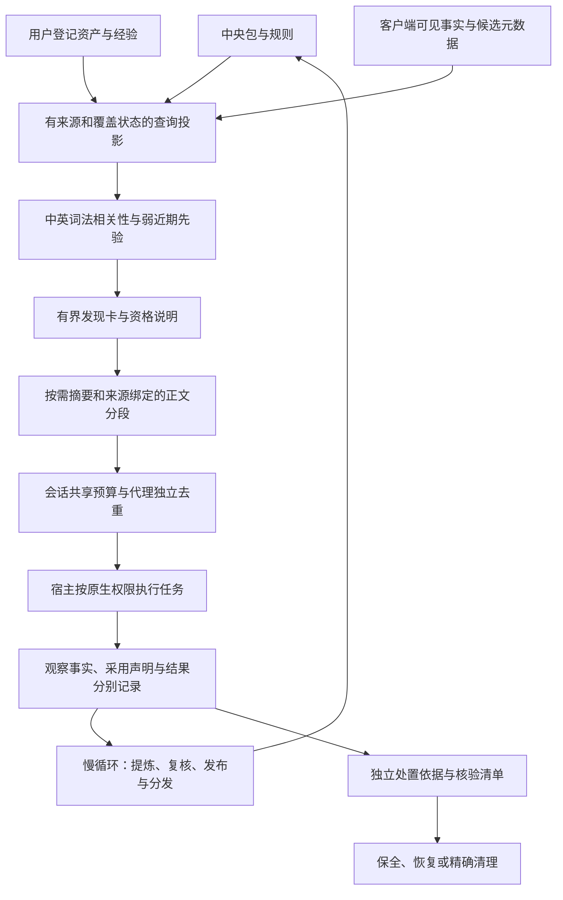

# 01 · Ted 能力生命周期架构

这是一个连接中央知识、个人经验和 AI 客户端的能力生命周期系统，让相关规则与技能在有限上下文中按需参与任务，并依据分层执行证据持续改进、受审升级和安全清理，同时不阻断用户已授权的任务。

本文更新于 2026-10-15，区分**已实现的源码、目标架构与部署证据**。1.9.1 范围的本轮源码整改（基于 1.9.0）已通过独立验收；正式发布事实以 tag/Release 与 CI 为准，安装和真实客户端生效另行验收。验收时本机仍为 1.8.4。版本安装状态不能由本文或仓库版本号推断，后续以对应客户端清单及实际回执为准。

## 架构原则与事实权威

采用本地优先的模块化引擎，保留现有四类包、个人资料目录与来源登记；不另外建立一套资产事实源。检索、短摘要、采用声明、业务结果与升级回执分别记录。

| 事实域 | 权威内容 | 不可替代的事实 |
|---|---|---|
| 中央资料域 | 已评审的 skill / knowledge / framework / role、跨包规则、预设及发布版本 | 候选 PR、目录存在或复制成功不等于发布 |
| 用户资料域 | 用户原文、来源与归属、个人登记、复核和明确处置决定 | 保全、统计、摘要完整或低热度不等于升级、废弃授权 |
| 客户端执行域 | 宿主暴露的会话/回合/代理、工具事件、实际产物与加载记录 | 署名、自报或管理器未报错不证明业务成功与全面监督 |
| 查询投影 | 从以上来源生成的发现卡、双语摘要和相关性排序 | 投影可重建；排名不授予资格、执行或删除权限 |

中央下放经过用户数据中心的中央受管区再到客户端。反向升级经过客户端保全、明确登记的用户资产、受审中央候选及发布内容核验。来源、归属与升级状态分开；复制和模型声明不改变它们。

## 两个运行节奏

快速任务循环负责发现、选择、按需交付和轻量观察；较慢的治理循环负责提炼、候选复核、发布、汇总和清理。慢任务不得通过长锁或大批正文占用普通 Hook。

图中箭头表示数据关系；不表示所有步骤都已自动化。采集、审计、统计或上下文交付失败只能标记缺口与修复事项，不得扩大原生权限，也不得阻止普通已授权业务。历史核心 enforce 分支与统一入口的差异见 [11](11-执行介入架构.md)。

## 快速循环：发现、摘要与加载

1. `SessionStart` 提供项目范围，不签发最终回执；`UserPromptSubmit` 提供当前原生回合绑定。客户端级接入不以聊天启动目录作为准入条件，一个逻辑任务可关联多个项目。
2. `task_begin` 固定岗位、版本摘要和精确工具契约。岗位 PROFILE 按段去重交付；实际执行者为 platform agent。已固定契约的同回合动态扩展尚未实现，不事后改写历史契约消除告警。
3. `list_assets / find_skill / recommend_assets / list_packs` 使用统一的公开发现入口，返回短卡、覆盖状态和分页游标。`list_packs` 仅含包，不混入 rules/docs 卡。
4. 原描述、名称、标签、别名、标题、入口正文及有效双语摘要参与词法检索。入口正文只进入查询期投影，不随发现卡返回，也不写入库存正文。中央包内 Markdown、仓库规则和文档另有可定位卡；待审候选只暴露元数据，不自动激活。
5. 相关性先决定是否召回，近期先验只作弱排序：当前仅消费带逻辑任务标识及相同资产修订的模型采用声明，按任务去重、随时间衰减，加成上限 2%。曝光、推荐、读取与重复交付不制造热度；声明不变成已验证采用或质量分。
6. 双语采用 zh-CN/en 派生字段，不另设语言环境；原文和原描述保留。缓存绑定来源、描述、元数据、版本及策略，变更即失效。语义仍标记 model-declared-unverified；日常 Hook 不逐次调用模型翻译全库。
7. `load_asset` 默认提供确定性摘录和章节游标，正文通过绑定 SHA-256 与 UTF-8 位置的游标分段读取。规则文档使用 `documentId/sourceSha256`；包入口保留 `source/type/name/entry` 路线。读全与实际采用分别记账。

发现投影有明确范围和读取预算，超限、读取失败和不可支持来源须可见；不承诺任意规则零遗漏。显式正文投影上限不代表旧库存遍历与 bundle 哈希路径已经拥有统一 I/O 上限。细节见 [12](12-资产发现与使用追踪.md)。

## 外部结构化判断通道

Jev 是可选判断通道：对已有充分事实的有限选项、批量分类或有固定量表的评分，可显式调用并抽查；开放式设计、写作、普通退出码检查及确定性规则不额外外包。当前 registry 的 company-required 是接入治理分类，不代表系统已把所有判断自动分流给 Jev。实际分流主要依赖模型和技能选择，尚无稳定的机会登记与净收益指标。

调用不可达或升级信号返回主执行者处理，不形成普通工具的额外审批。全局 jev_gate Hook 需要单独明确授权，不因工具可用或本架构说明自动部署。当前保持既有按需触发，不设置调用次数目标。准确率、总延迟与成本收益须在自然出现的真实批量任务中用同批对照验证；有净收益证据再考虑增加分流，不能以 API 请求多寡或一次连通性成功代替。

## 上下文交付边界

| 控制范围 | 当前源码基线 | 说明 |
|---|---|---|
| 发现页 | 默认 8 项 / 完整 JSON 4096 B；最高 32 项 / 8192 B | 游标绑定查询及来源/排序快照；超大单卡显式延后，不能挡住后续规则 |
| 摘录与正文响应 | 摘录 2048 B；完整响应上限 8192 B | 包含受控 JSON 转义和元数据；摘录不保证保留全部条件与例外 |
| Hook 合并响应 | 12288 B | 同回合、代理、context epoch 逐段去重；事件 captureId 不作恢复代次 |
| 回合累计 | 65536 B | 同一原生 session/turn 内所有代理共享，不能每个子代理领取一份额度 |
| 会话累计 | 262144 B | 同一原生 session 共享；去重标记按 agent 隔离，普通新回合不重置会话额度 |
| 写操作故障控制 | 目标不超过 1024 B | 白名单 `operationOutcome` 保留已返回的本地对象与业务状态；交付失败不抹掉实际写入 |

单位为适配器受控正文的 UTF-8 字节，不是模型 token、实际费用或宿主驻留上下文。缺少 session/turn 时仅有单次硬限额，累计记账明确 unbound。预算耗尽或账本故障不交付可选正文，保留有界控制和未知事实。

当前账本为共享 JSON 文件与本机锁，尚无 host ACK、outbox 或完整崩溃恢复事务。旧账本仅导入父代理及实际遇到的子代理，部署切换须停止旧写者；不能宣称混合新旧写者已完整对账。`ted summary` 的 inspect 默认只读；prepare/submit 是显式双语维护操作。不重置预算、不宣称清空宿主上下文，也不把恢复预览称为完整任务恢复包。入口见 [15](15-Ted聊天入口与验收.md)。

## 慢循环：升级与安全清理

自动提取按来源快照、索引页和片段读取，索引全量留盘，返回内容参与累计预算；冻结来源未连续读全、已变化或超限时不得推进覆盖水位。单坏来源的独立进度/backlog、统一晋升状态转换及完整恢复协议仍需后续补齐。摘要生成、候选登记、试用、人工复核、中央发布是不同阶段；现有精确发布文件和 SHA 核验不能放宽成一句 approved。

| 对象 | 清理依据与当前实现 | 边界 |
|---|---|---|
| 可重建 runtime 缓存 | 受管路径与保留期；拒绝符号链接，精确删除文件 | 仍需完整生成器/保留根与容量治理，不能泛化为任意目录 TTL 删除 |
| 原始事件日志 | 保留窗口、具体日志 SHA、已核验汇总及任务终态回执 | 汇总不能替代最小执行证明；真实生产者消费闭环仍待完善 |
| 明确废弃资料 | 具体版本处置依据、路径/摘要、严格 ISO 日期及保留期 | 未知来源、搬迁或读取失败不构成废弃 |
| 唯一经验原文 | 可恢复隔离；删除另需绑定原文路径与 SHA 的 `discardAuthorization` | 摘要复核不授权删除；旧记录无独立依据时到期仍保留可恢复 |

经验映射使用完整连续的 UTF-8 字节区间和候选中实际存在的唯一摘录，只证明机械覆盖，不证明摘要语义无损。清理前复核版本与候选，目录出现未登记文件则保留；只删除核验目标再非递归移除空目录。处置依据目前为显式本地操作员声明，不等于已认证用户身份。完整保留根、跨设备协调、对抗性路径竞态与删除后恢复事务仍未完成。治理原则见 [05](05-治理与反馈.md)，字段见 [15](15-Ted聊天入口与验收.md#安全回收的版本依据)。

## 实现落点与存储

源码路径均相对 `mcp/ted-avc-manager/src/`。

| 职责 | 主要模块 |
|---|---|
| 资产事实与库存 | `core/awareness.js`、`core/local-assets.js` |
| 统一公开发现与选择 | `core/asset-discovery.js`、`core/asset-selection.js`、`core/asset-search.js` |
| 来源绑定双语维护 | `core/summary-language.js` |
| 共享额度与分段交付 | `core/context-budget.js`、`core/execution.js` |
| 原生入口、工具身份与观察 | `native-hook.js`、`core/session-ingress.js`、`core/native-tools.js` |
| MCP / CLI / Ted 出口 | `server.js`、`cli.js`、`core/ted-commands.js` |
| 提炼、候选与清理 | `governance/weekly.js`、`governance/candidate-trials.js`、`governance/cleanup.js`、`governance/experience-recovery.js`、`core/discard.js` |
| 双向流转与客户端重建 | 仓库 `scripts/asset_lifecycle.py`、`scripts/client_environment.py` |

中央仓库只保存可发布源码、通用资料和文档；个人原文、凭据、账号及机器路径不入库。客户端 Hook/执行/预算状态从部署配置解析至对应客户端的 stateRoot，与用户持久资料分离；仓库 `runtime/` 保留仓库运行元数据与本地视图，不重定向宿主自管临时副本。初始化仍由确定性安装器先保全、重建中央受管客户端环境，再按需导入用户资产；用户数据初始化只增量补齐。详见 [08](08-个人目录规约.md) 和 [客户端重建设计](14-客户端初始化重建设计.md)。

本地与公开全景图共用生成器，私有资料在公开收集前隔离。公开视图只消费已发布 tag 与公开候选 PR 的固定提交元数据；Pages 在 master 上下文发布，tag 不单独部署，见 [发布流程](14-master发布流程.md)。

## 验收与后续阶段

2026-10-15 源码冻结验收：Node 270/270、Python 47/47，7 项项目门禁通过；原专家组安全架构专家独立复验关闭 3 项 P2、一次集合回归及 CLEAN-01..04。该快照对应当时 31 文件增量，后续文档更新不改写已关闭的证据清单，也不把旧测试冒充更新后重新运行。

后续仍需完成：经复核的动作模板与适用/例外集合、真实保留集检索质量评估、SQLite provider 及事务迁移、交付确认与恢复包、逐来源升级与汇总消费闭环、完整三类清理协议，以及指定客户端安装后的真实时序和跨代理绑定验收。SQLite 是目标设计，当前未迁移。

本轮验收与部署状态见 [09](09-实现与验收状态.md)。完整架构、安装成功、原生事件采集、上下文交付、实际采用和业务效果分别验收；任一项不得由其他项代替。

后续增量：本地实时监控页将复用已有事件，以增量读取呈现发现、正文交付、读取完成、采用声明及关联工具/产物证据；未知状态单列，不把模型内部遵守情况宣称为可直接观测。该能力留到下一版开发，不属于本次发布实现，也不额外注入模型上下文。
